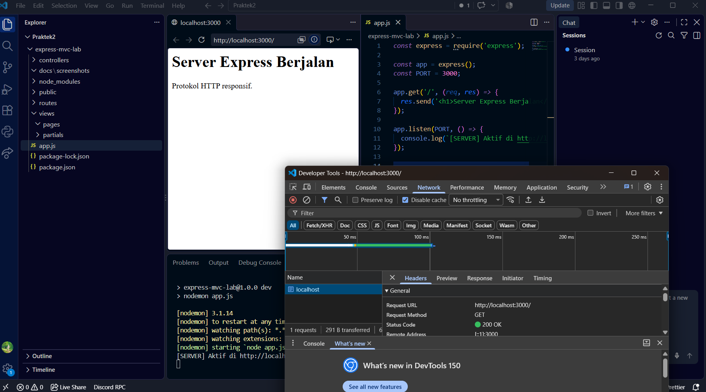
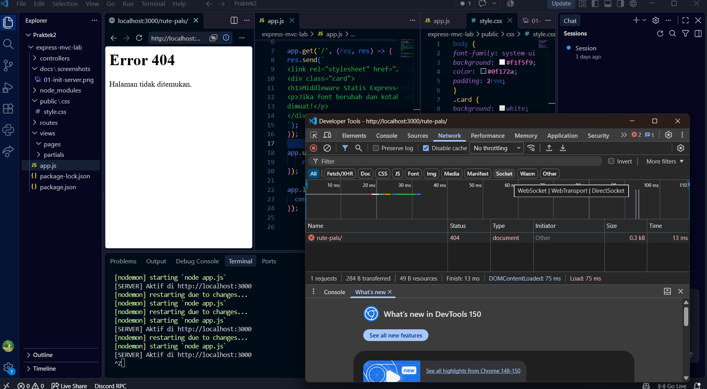
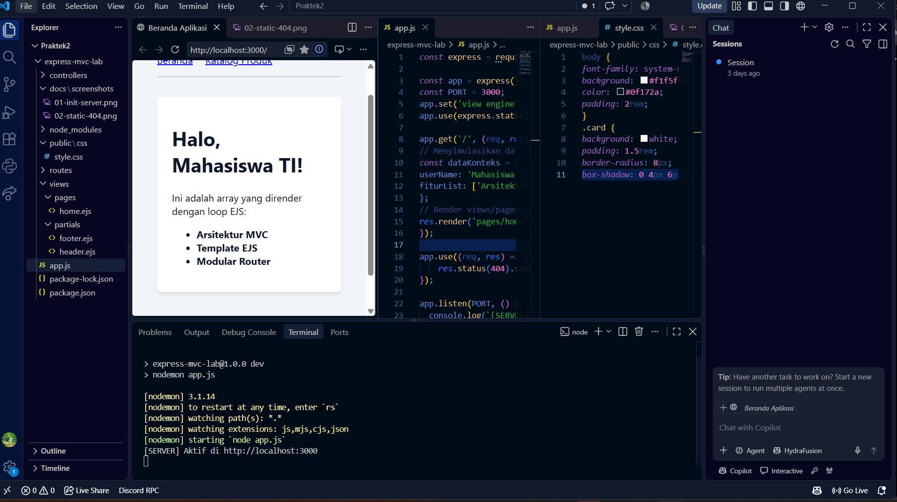
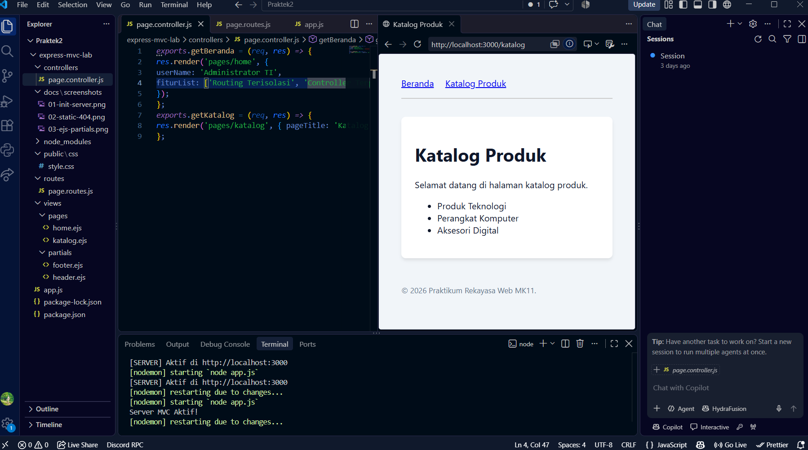
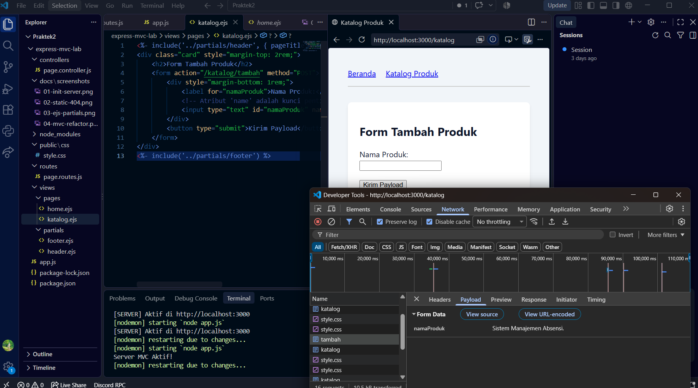
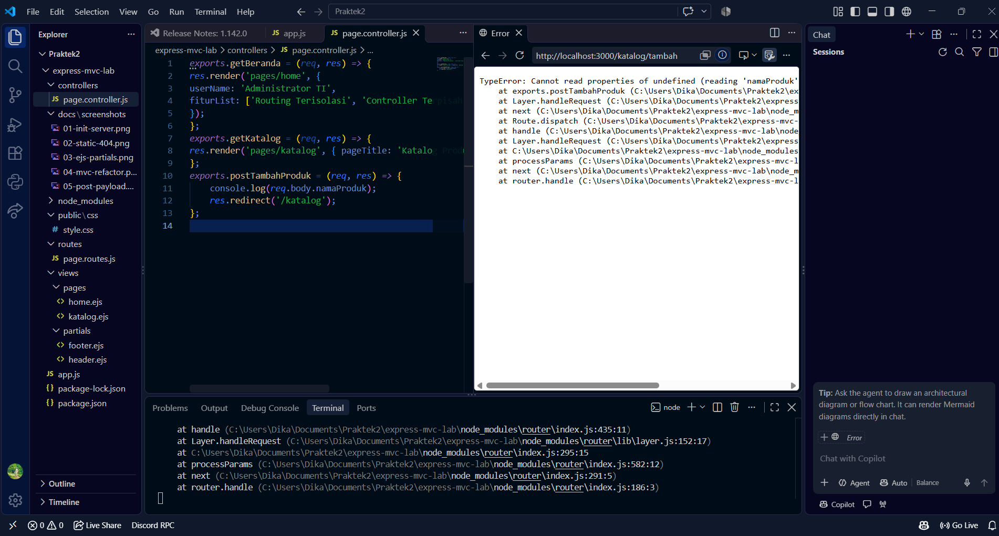
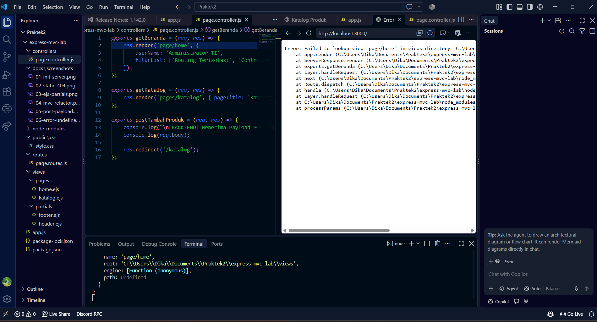

# Praktikum 2 — Arsitektur Back-End Web Server

**Mata Kuliah:** Pemrograman Web 
**Topik:** Express.js, Template Engine EJS, dan Pola Desain MVC (Monolith SSR)

**Nama:** [I Gede Dika Mahendra Putra]  
**NIM:** [42530027]  

---

## 1. Deskripsi Praktikum

Praktikum ini berfokus pada pengembangan aplikasi back-end menggunakan Node.js dan Express.js dengan pendekatan *Monolithic Server-Side Rendering* (SSR). Kegiatan meliputi pengelolaan HTTP request dan response, penggunaan middleware untuk menyajikan aset statis dan memproses data formulir, serta penerapan EJS sebagai template engine untuk menghasilkan halaman web dinamis.

Selain itu, praktikum menerapkan pola arsitektur Model-View-Controller (MVC) untuk memisahkan tanggung jawab setiap bagian aplikasi. Pengujian juga dilakukan melalui Browser Developer Tools dan investigasi error untuk memahami proses kerja server serta mengidentifikasi penyebab kesalahan pada aplikasi.

## 2. Tujuan Praktikum

Praktikum ini bertujuan untuk:

1. Menginisialisasi proyek Node.js dan memasang dependensi Express.js, EJS, serta Nodemon.
2. Menjalankan server Express.js dan memeriksa HTTP request-response melalui Browser Developer Tools.
3. Mengimplementasikan middleware untuk menyajikan aset statis dan menangani respons HTTP 404.
4. Menggunakan EJS dan partials untuk membangun halaman web dinamis yang dapat digunakan kembali.
5. Menerapkan pola MVC dengan memisahkan routing, controller, dan view.
6. Memproses data formulir menggunakan metode HTTP POST dan menerapkan pola Post-Redirect-Get (PRG).
7. Melakukan pengujian, analisis, dan perbaikan error pada aplikasi back-end.

## 3. Persiapan Lingkungan Kerja

Pengembangan dilakukan menggunakan Node.js dan npm sebagai pengelola dependensi. Express.js digunakan untuk menangani routing dan middleware, EJS untuk merender halaman HTML dinamis, serta Nodemon untuk memantau perubahan kode dan memulai ulang server secara otomatis selama proses pengembangan.

Dependensi yang digunakan:
- **Node.js:** Runtime JavaScript.
- **Express.js:** Framework untuk membangun server web.
- **EJS:** Template engine untuk menghasilkan halaman HTML dinamis.
- **Nodemon:** Utilitas untuk memulai ulang server ketika kode berubah.

Perintah instalasi dependensi:

```bash
npm init -y
npm install express ejs
npm install --save-dev nodemon
```

Konfigurasi pada bagian `scripts` di `package.json`:

```json
"scripts": {
  "start": "node app.js",
  "dev": "nodemon app.js"
}
```

Server pengembangan dijalankan menggunakan:

```bash
npm run dev
```

> Catatan: Pada Windows PowerShell, apabila perintah `npm` terkendala kebijakan eksekusi, gunakan `npm.cmd run dev`.

## 4. Struktur Direktori Proyek

Struktur direktori disusun untuk memisahkan file server, routing, controller, tampilan, dan aset statis agar pengembangan lebih terorganisasi.

```text
express-mvc-lab/
├── app.js
├── package.json
├── package-lock.json
├── public/
│   └── css/
│       └── style.css
├── routes/
│   └── page.routes.js
├── controllers/
│   └── page.controller.js
├── views/
│   ├── pages/
│   │   ├── home.ejs
│   │   └── katalog.ejs
│   └── partials/
│       ├── header.ejs
│       └── footer.ejs
└── docs/
    └── screenshots/
```

## 5. Implementasi dan Pengujian Praktikum

Bagian ini mendokumentasikan tahapan implementasi, hasil pengujian, serta pengamatan terhadap perilaku aplikasi pada setiap pengalaman laboratorium.

### 5.1 Pengalaman 1 — Inisialisasi Server dan Inspeksi HTTP

**Tujuan:** Memahami proses dasar komunikasi antara browser dan server Express.js.

Pada tahap ini, server Express.js dibuat dengan endpoint `GET /` yang menampilkan teks `Server Express Berjalan`. Server dijalankan menggunakan Nodemon, kemudian diakses melalui browser pada alamat `http://localhost:3000`.

Pemeriksaan dilakukan melalui tab **Network** pada Browser Developer Tools untuk mengamati status code, response headers, dan request headers.

**Hasil pengamatan:**

- Status code `200 OK` menunjukkan bahwa permintaan berhasil diproses.
- Header `Content-Type` menunjukkan jenis konten respons yang dikirimkan server.
- Header `X-Powered-By: Express` menunjukkan framework yang digunakan server, apabila header tersebut tidak dinonaktifkan.

**Dokumentasi:**



### 5.2 Pengalaman 2 — Aset Statis dan HTTP 404

**Tujuan:** Memahami penyajian file statis dan penanganan rute yang tidak ditemukan.

Middleware `express.static('public')` ditambahkan agar file seperti CSS dapat diakses langsung oleh browser. Selanjutnya, halaman utama dihubungkan dengan stylesheet `style.css` untuk menerapkan tampilan dasar.

Pengujian dilakukan dengan membuka halaman utama dan mengakses URL yang tidak terdaftar, yaitu `/rute-palsu`.

**Hasil pengamatan:**

- File CSS memperoleh status `200 OK` apabila berhasil dimuat.
- URL `/rute-palsu` menghasilkan status `404 Not Found` karena tidak terdapat rute yang sesuai.
- Middleware penanganan 404 digunakan untuk memberikan respons ketika permintaan tidak cocok dengan rute yang tersedia.

**Dokumentasi:**



### 5.3 Pengalaman 3 — Implementasi EJS dan Partials

**Tujuan:** Menghasilkan halaman web dinamis menggunakan EJS serta mengurangi pengulangan struktur HTML.

EJS didaftarkan sebagai template engine melalui konfigurasi `app.set('view engine', 'ejs')`. Struktur halaman dibagi menjadi beberapa bagian, yaitu `header.ejs`, `footer.ejs`, dan `home.ejs`.

Data seperti `pageTitle`, `userName`, dan `fiturList` dikirimkan dari server ke template untuk ditampilkan pada halaman. Penggunaan `include()` memungkinkan header dan footer digunakan kembali tanpa perlu menuliskan struktur yang sama pada setiap halaman.

**Hasil pengamatan:**

- EJS menampilkan data yang dikirimkan melalui objek konteks pada fungsi `res.render()`.
- Partials membantu menjaga konsistensi tampilan dan mengurangi duplikasi kode HTML.
- Halaman dapat diperbarui tanpa menyusun ulang seluruh struktur dokumen HTML.

**Dokumentasi:**



### 5.4 Pengalaman 4 — Refactoring dengan Pola MVC

**Tujuan:** Memisahkan tanggung jawab aplikasi agar struktur kode lebih terorganisasi dan mudah dikembangkan.

Aplikasi direfaktor dengan memisahkan pengelolaan rute ke dalam `routes/page.routes.js` dan logika pemrosesan permintaan ke dalam `controllers/page.controller.js`. File EJS ditempatkan pada direktori `views/`.

Pembagian tanggung jawabnya adalah:

- **`app.js`:** Menginisialisasi Express, mengatur middleware, menetapkan template engine, dan memasang router.
- **`routes/`:** Mendefinisikan endpoint dan menghubungkan permintaan dengan fungsi controller.
- **`controllers/`:** Mengelola logika pemrosesan permintaan serta menentukan respons yang diberikan.
- **`views/`:** Menyimpan template EJS yang digunakan untuk menampilkan halaman kepada pengguna.

Pengujian dilakukan dengan mengakses `http://localhost:3000/katalog` untuk memastikan halaman katalog berhasil dirender.

**Hasil pengamatan:**

Pemisahan komponen membuat kode lebih mudah dibaca, mempermudah pemeliharaan, dan mengurangi ketergantungan antara routing, logika aplikasi, serta tampilan.

**Dokumentasi:**



### 5.5 Pengalaman 5 — HTTP POST dan Pola Post-Redirect-Get

**Tujuan:** Memahami pengiriman data formulir melalui HTTP POST dan alur Post-Redirect-Get (PRG).

Formulir penambahan produk dibuat pada halaman katalog dengan atribut `action="/katalog/tambah"` dan `method="POST"`. Input menggunakan atribut `name="namaProduk"` sebagai identitas data yang dikirimkan ke server.

Middleware `express.urlencoded({ extended: true })` diaktifkan sebelum router agar data formulir dapat dibaca melalui `req.body`. Data yang diterima ditampilkan pada terminal menggunakan `console.log()`, kemudian pengguna diarahkan kembali ke halaman katalog melalui `res.redirect('/katalog')`.

**Hasil pengamatan:**

- Atribut `name` menentukan nama properti data yang dikirimkan oleh formulir.
- Middleware `express.urlencoded()` memproses data formulir berformat URL-encoded.
- Data dapat diperiksa melalui bagian **Payload** pada tab Network dan melalui terminal server.
- Pola PRG mengarahkan pengguna kembali ke halaman melalui permintaan GET setelah POST diproses, sehingga mengurangi risiko pengiriman ulang formulir ketika halaman dimuat ulang.

**Dokumentasi:**



### 5.6 Investigasi Error 1 — `Cannot read properties of undefined`

**Tujuan:** Mengetahui dampak ketika middleware parsing data formulir tidak diaktifkan.

Pengujian dilakukan dengan menonaktifkan sementara middleware `express.urlencoded({ extended: true })`, kemudian mengirimkan formulir dari halaman katalog. Pada controller, aplikasi mencoba mengakses `req.body.namaProduk`.

**Hasil pengamatan:**

Ketika middleware parser tidak diaktifkan, `req.body` dapat bernilai `undefined` untuk permintaan formulir URL-encoded. Akibatnya, akses terhadap properti `namaProduk` menghasilkan `TypeError` karena properti tersebut dibaca dari nilai yang tidak tersedia.

Perbaikan dilakukan dengan mengaktifkan kembali middleware parser sebelum router dipasang.

**Dokumentasi:**



### 5.7 Investigasi Error 2 — `Failed to lookup view`

**Tujuan:** Memahami kesalahan pencarian template ketika nama view tidak sesuai dengan struktur direktori.

Pengujian dilakukan dengan mengubah sementara tujuan render menjadi `res.render('page/home', ...)`, padahal template yang tersedia berada di direktori `views/pages/home.ejs`.

**Hasil pengamatan:**

Express mencari template berdasarkan nama view relatif terhadap direktori views yang dikonfigurasi. Ketidaksesuaian nama direktori menyebabkan Express gagal menemukan template dan menampilkan error `Failed to lookup view`.

Perbaikan dilakukan dengan mengembalikan pemanggilan menjadi `res.render('pages/home', ...)`.

**Dokumentasi:**




## 6. Kesimpulan

Praktikum ini memberikan pemahaman mengenai proses pembangunan aplikasi back-end menggunakan Node.js dan Express.js, mulai dari inisialisasi server hingga penerapan pola MVC dengan EJS sebagai template engine.

Pengujian HTTP melalui Browser Developer Tools membantu menjelaskan hubungan antara request dan response, sedangkan penggunaan middleware mendukung penyajian aset statis dan pemrosesan data formulir. Penerapan pola PRG memperjelas alur penanganan formulir, sementara investigasi error menunjukkan pentingnya konfigurasi middleware dan ketepatan penamaan view.

Secara keseluruhan, praktikum ini menunjukkan bahwa pemisahan komponen aplikasi dan pengujian secara bertahap membantu menghasilkan kode yang lebih terstruktur, mudah dipelihara, serta lebih mudah ditelusuri ketika terjadi kesalahan.

